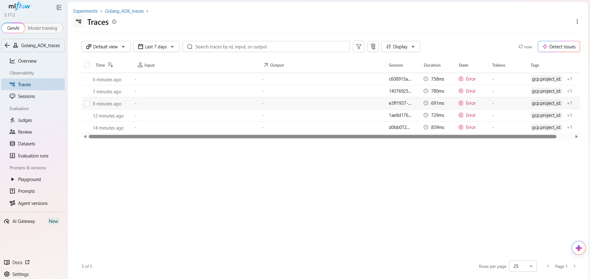
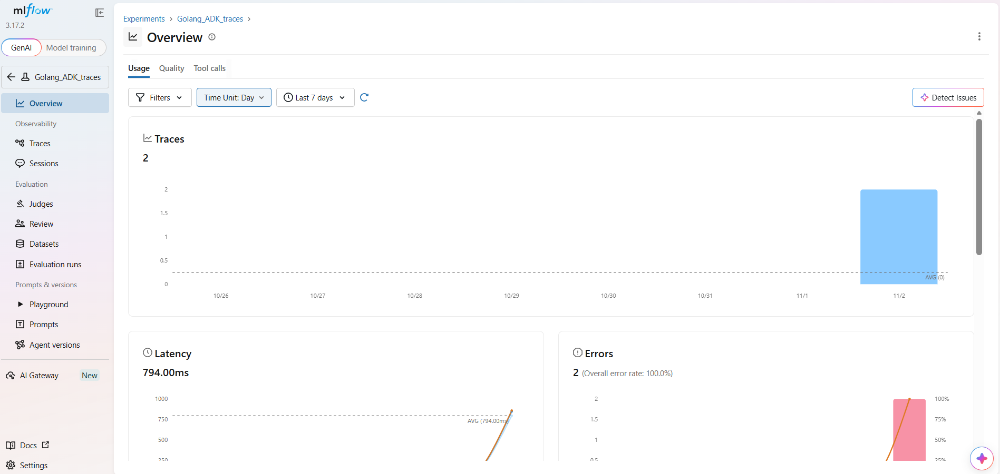

# Agent Observability with MLflow

Local stack for observing Google Agent Development Kit (ADK) agents in Go. The agent emits OpenTelemetry spans; MLflow Tracking Server ingests them over OTLP/HTTP and stores run metadata in PostgreSQL and artifacts in an S3-compatible object store.

This is not an MLflow SDK integration. The Go agent never talks to MLflow's Python or REST tracking APIs. Google ADK already initializes an OTLP HTTP exporter when the standard OpenTelemetry environment variables are set. MLflow (3.6+) exposes `/v1/traces` and accepts those spans if a SQL backend is configured.

## Architecture

```
                         +---------------------------+
                         |  Operator / end user      |
                         |  console or ADK Web UI    |
                         +-------------+-------------+
                                       |
                                       | prompt
                                       v
                         +---------------------------+
                         |  Go demo agent            |
                         |  demo_agent/agent.go      |
                         |                           |
                         |  Google ADK v2 launcher   |
                         |  LLM: Gemini              |
                         |  Tool: Google Search      |
                         +------+--------------+-----+
                                |              |
               OpenTelemetry    |              |  model / tool calls
               OTLP/HTTP        |              v
               traces + logs    |     +------------------+
                                |     | Gemini API       |
                                |     | Google Search    |
                                |     +------------------+
                                v
                         +---------------------------+
                         |  MLflow Tracking Server   |
                         |  :5000                    |
                         |                           |
                         |  UI  /  REST  /  OTLP     |
                         |  POST /v1/traces          |
                         +------+--------------+-----+
                                |              |
                 metadata       |              |  artifacts
                 (experiments,  |              |  (s3://mlflow)
                  traces,       |              |
                  sessions)     |              |
                                v              v
                   +----------------+   +------------------+
                   | PostgreSQL     |   | RustFS           |
                   | :5432          |   | S3 API  :9000    |
                   |                |   | Console :9001    |
                   | required for   |   | bucket: mlflow   |
                   | OTLP ingest    |   +------------------+
                   +----------------+
```

All infrastructure services share the Docker network `mlflow-network`. The Go agent runs on the host, so it reaches MLflow at `http://localhost:5000`.

### Request path

1. The operator starts the agent (`console` or `web api webui`).
2. ADK reads `OTEL_EXPORTER_OTLP_ENDPOINT`. If it is set, ADK creates an OTLP HTTP span exporter (`otlptracehttp`) and a matching log exporter. No extra instrumentation code is required in `agent.go`.
3. The SDK appends the OTLP signal path. Traces go to `http://localhost:5000/v1/traces`.
4. Each export includes `x-mlflow-experiment-id`. MLflow uses that header to attach the trace to an experiment (`0` is the default experiment; any ID from the UI or API also works).
5. MLflow writes trace metadata to PostgreSQL and stores artifacts in the `mlflow` bucket on RustFS.
6. The MLflow GenAI UI (`http://localhost:5000`) shows traces, sessions, latency, and error rate.

MLflow's OTLP endpoint is HTTP only. gRPC is not supported. ADK Go already uses the HTTP exporter, so the protocols match.

### Why PostgreSQL

OTLP ingest is supported only with a SQL backend (PostgreSQL, MySQL, MSSQL, SQLite). A file-based MLflow store will not accept `/v1/traces`. This compose stack uses PostgreSQL for that reason.

### Why an S3-compatible store

MLflow is started with `--serve-artifacts` and `--artifacts-destination s3://mlflow`. RustFS is the local S3 gateway. The one-shot `create-bucket` job creates the bucket before the tracking server starts.

## Repository layout

```
.
|-- docker-compose.yml     MLflow, PostgreSQL, RustFS, bucket init
|-- .env.example           compose and agent secrets (copy to .env)
|-- demo_agent/agent.go    Google ADK Go agent (Gemini + Google Search)
|-- go.mod / go.sum
|-- docs/traces.png        MLflow Traces view
|-- docs/analytics.png     MLflow Overview (usage / latency / errors)
```

## Components

### Go demo agent

`demo_agent/agent.go` builds a single LLM agent named `hello_time_agent`:

- Model: `gemini-3.7-flash` via `GOOGLE_API_KEY`
- Tool: `geminitool.GoogleSearch`
- Runtime: `full.NewLauncher()` (console by default; web UI with `web api webui`)

ADK Go (`google.golang.org/adk/v2`) wires OpenTelemetry inside the launcher. Setting `OTEL_EXPORTER_OTLP_ENDPOINT` is enough to turn export on.

### MLflow Tracking Server

Container `mlflow-server`, image `ghcr.io/mlflow/mlflow`. Started with:

- `--backend-store-uri` pointing at PostgreSQL
- `--artifacts-destination s3://mlflow`
- `--serve-artifacts`
- host `0.0.0.0`, port `5000`

The server is the OTLP collector for this project. There is no separate OpenTelemetry Collector.

### PostgreSQL 15

Backend store for experiments, traces, and MLflow metadata. Health-checked with `pg_isready` before MLflow starts.

### RustFS

S3-compatible object storage used as MLflow's artifact destination.

| Port | Role        |
|------|-------------|
| 9000 | S3 API      |
| 9001 | RustFS console |

### create-bucket

One-shot AWS CLI container. After RustFS is healthy it creates `s3://mlflow` if the bucket does not exist, then exits. MLflow waits for this job.

## Ports

| Port | Service              |
|------|----------------------|
| 5000 | MLflow UI, REST, OTLP `/v1/traces` |
| 5432 | PostgreSQL           |
| 9000 | RustFS S3 API        |
| 9001 | RustFS console       |
| 8080 | ADK Web UI (when started with `web api webui`) |

## Prerequisites

- Docker with Compose
- Go 1.25 or later
- A Gemini-capable `GOOGLE_API_KEY`

## Run

Start the observability stack first, then the Go agent. OpenTelemetry variables must be set in the same shell that launches the agent. Google ADK reads them at process start.

### 1. Environment file

Copy the example file and fill in `GOOGLE_API_KEY`. Compose reads `.env` automatically for the infrastructure services.

**Linux / macOS**

```bash
cp .env.example .env
```

**Windows (cmd)**

```bat
copy .env.example .env
```

Edit `.env` and set:

```
GOOGLE_API_KEY=your-key
```

The remaining values (Postgres, S3, MLflow URIs) work as shipped for local use.

### 2. Start Compose

From the repository root:

```bash
docker compose up -d
```

Wait until `mlflow-server` is healthy, then open [http://localhost:5000](http://localhost:5000).

Experiment ID `0` is MLflow's default experiment. To use a named experiment, create one in the UI (for example `Golang_ADK_traces`) and note the numeric ID shown in the experiment URL or details. That ID is what you put in `OTEL_EXPORTER_OTLP_HEADERS` below.

### 3. OpenTelemetry variables (required before the agent)

Google ADK enables OTLP export from these variables. Set them in the shell, then start the agent in that same shell.

`OTEL_EXPORTER_OTLP_ENDPOINT` is the MLflow base URL. ADK's OTLP HTTP exporter appends `/v1/traces`. Do not point this at a Collector; MLflow is the ingest endpoint.

`OTEL_EXPORTER_OTLP_HEADERS` must include `x-mlflow-experiment-id`. Use `0` for the default experiment, or the ID of an experiment you created.

**Windows (cmd)**

```bat
set OTEL_EXPORTER_OTLP_ENDPOINT=http://localhost:5000
set OTEL_EXPORTER_OTLP_HEADERS=x-mlflow-experiment-id=0
set GOOGLE_API_KEY=your-key
```

**Linux / macOS**

```bash
export OTEL_EXPORTER_OTLP_ENDPOINT=http://localhost:5000
export OTEL_EXPORTER_OTLP_HEADERS=x-mlflow-experiment-id=0
export GOOGLE_API_KEY=your-key
```

Replace `0` with a custom experiment ID if you created one, for example:

```
x-mlflow-experiment-id=123
```

These variables are process environment, not Docker Compose settings. They do not belong in `.env` unless you export them yourself before `go run`.

### 4. Run the Go agent

From the repository root, in the same shell as step 3.

Console (default):

```bash
go run ./demo_agent
```

ADK Web UI (http://localhost:8080):

```bash
go run ./demo_agent web api webui
```

Send a prompt (for example: ask the current time in a city). ADK records the agent run, model call, and tool spans and flushes them to MLflow.

### 5. Inspect traces

Open [http://localhost:5000](http://localhost:5000), select the experiment, then **Traces** or **Overview**.

Traces list (session, duration, state, tags):



Usage overview (trace volume, latency, error rate):



## Configuration reference

Values come from `.env` (see `.env.example`).

| Variable | Used by | Purpose |
|----------|---------|---------|
| `GOOGLE_API_KEY` | Go agent | Gemini API access |
| `POSTGRES_USER` / `POSTGRES_PASSWORD` / `POSTGRES_DB` / `PGPORT` | Postgres, MLflow | Backend store |
| `AWS_ACCESS_KEY_ID` / `AWS_SECRET_ACCESS_KEY` / `AWS_DEFAULT_REGION` | RustFS, MLflow, create-bucket | S3 credentials |
| `S3_BUCKET` | create-bucket, MLflow | Artifact bucket (`mlflow`) |
| `MLFLOW_S3_ENDPOINT_URL` | MLflow, create-bucket | In-network S3 URL (`http://storage:9000`) |
| `MLFLOW_BACKEND_STORE_URI` | MLflow | `postgresql://...@postgres:5432/mlflow` |
| `MLFLOW_ARTIFACTS_DESTINATION` | MLflow | `s3://mlflow` |
| `MLFLOW_HOST` / `MLFLOW_PORT` | MLflow | Bind `0.0.0.0:5000` |
| `OTEL_EXPORTER_OTLP_ENDPOINT` | Go agent (ADK) | MLflow base URL |
| `OTEL_EXPORTER_OTLP_HEADERS` | Go agent (ADK) | `x-mlflow-experiment-id=<id>` |

## Stop

```bash
docker compose down
```

Volumes `pgdata` and `storage-data` keep traces and artifacts across restarts. Add `-v` only if you want a clean database and object store.
